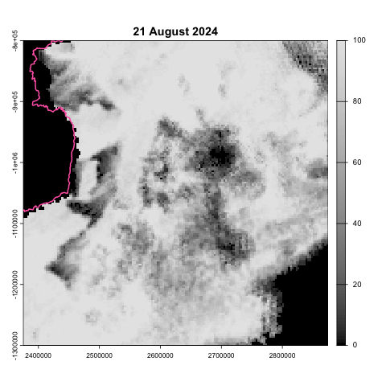
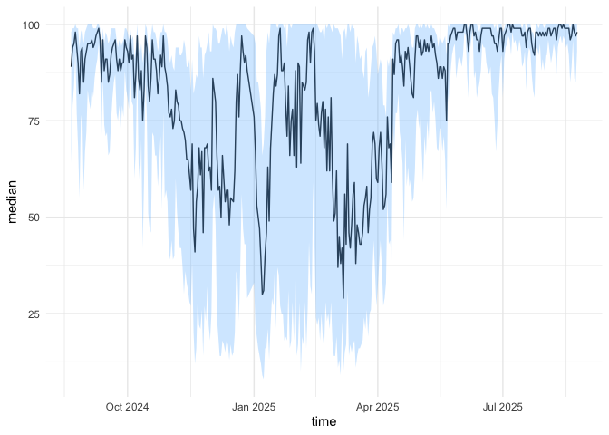
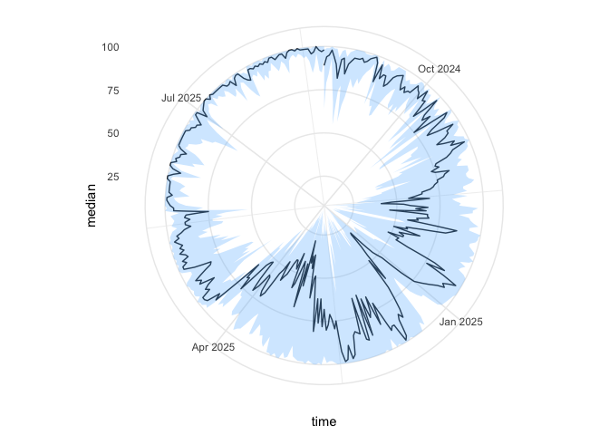

<!-- README.md is generated from README.Rmd. Please edit that file -->

# icebreaker

<!-- badges: start -->

<!-- badges: end -->

The goal of icebreaker is to practice using geotargets to answer
questions and use real data.

In this case, thanks to the gracrious assstance of
[@mdsumner](https://github.com/mdsumner/), we explore how sea ice near
[Casey Station](https://en.wikipedia.org/wiki/Casey_Station) in
Antarctica changes over time.

We used [geotargets](https://github.com/njtierney/geotargets) and
[dynamic
branching](http://geotargets.njtierney.com/articles/tar_terra_tiles.html)
to cleverly read in many rasters and not overload local memory.

As a first exploration, we produced this gif:

<figure>

<figcaption aria-hidden="true">Sea ice changes over time near Casey
station</figcaption>
</figure>

## sea ice summaries

``` r
library(targets)
tar_source()
source("packages.R")
#> 
#> Attaching package: 'arrow'
#> The following object is masked from 'package:utils':
#> 
#>     timestamp
#> terra 1.8.70
tar_load(ice_summary)
tar_load(plotted_ice_summaries)
date_summary <- summary(ice_summary$time)
date_summary
#>                  Min.               1st Qu.                Median 
#> "2024-08-21 00:00:00" "2024-11-20 00:00:00" "2025-02-23 00:00:00" 
#>                  Mean               3rd Qu.                  Max. 
#> "2025-02-21 14:04:16" "2025-05-25 00:00:00" "2025-08-24 00:00:00"
```

We can get the aggregate of ice thickness by microwave - we can see the
dates from 2024-08-21 to 2025-08-24.

``` r
ice_summary
#> # A tibble: 365 × 6
#>    time                  min    q1 median    q3   max
#>    <dttm>              <dbl> <dbl>  <dbl> <dbl> <dbl>
#>  1 2024-08-21 00:00:00     1    64     89    98   100
#>  2 2024-08-22 00:00:00     1    79     94    99   100
#>  3 2024-08-23 00:00:00     1    84     95    99   100
#>  4 2024-08-24 00:00:00     1    93     98   100   100
#>  5 2024-08-25 00:00:00     1    77     94    99   100
#>  6 2024-08-26 00:00:00     1    68     90    99   100
#>  7 2024-08-27 00:00:00     1    55     82    94   100
#>  8 2024-08-28 00:00:00     1    75     93    98   100
#>  9 2024-08-29 00:00:00     1    78     94    99   100
#> 10 2024-08-30 00:00:00     1    57     85    95   100
#> # ℹ 355 more rows
```

We can also plot the median sea ice thickness

``` r
plotted_ice_summaries
```

<!-- -->

And even have this as a POLAR CO-ORDINATE system!

``` r
plotted_ice_summaries + coord_polar()
```

<!-- -->
